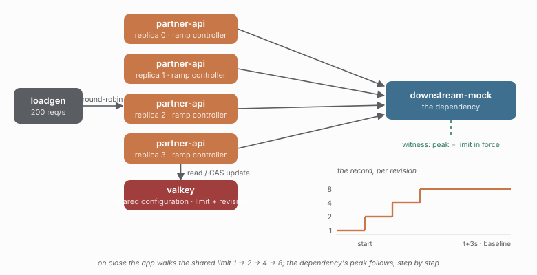

# 16 - A recovery ramp the application owns

> **Question:** Who decides how fast a ceiling comes back after the breaker closes?

```sh
npm run demo 16
npm run compare 02 16
```



## What it sets up

Study 02's four-replica distributed bulkhead at `limit: 8`, plus a breaker and a
**recovery controller inside the application**. The library owns the ceiling; it
does not own the policy for moving it. When the breaker closes, the controller
reads the shared configuration record, and steps the limit back up
`1 -> 2 -> 4 -> 8`, one step per second, through compare-and-set. When the breaker
re-opens, it drops the record to the floor and waits for the next close.

The timeline drives the dependency, not the process:

```text
1s   dependency fails       -> breaker opens, limit drops to 1
3s   dependency recovers    -> half-open probe closes the breaker
3s+  ramp: 1 -> 2 -> 4 -> 8 -> the constructor baseline
```

## The claim

The ceiling the dependency saw was the ceiling in force at that moment, step by
step. The dependency's own 10ms in-flight timeline is the judge:

| limit in force | dependency peak in flight | samples in window |
| -------------- | ------------------------: | ----------------: |
| 1              |                         1 |                46 |
| 2              |                         2 |                45 |
| 4              |                         4 |                46 |
| 8              |                         8 |               825 |

```text
start     value=1  revision=1  (3ms after the close event)
step      value=2  revision=2
step      value=4  revision=3
complete  value=8  revision=4
```

Every step is one record write, and the revision advances by exactly one each
time: a single writer wins each CAS, and the ladder is the history of the record,
not of a process. The run's other numbers:

```text
witness         peak in flight 8, peak 65 req/s, 939 requests, 58 failures
client          881/4432 ok, refused {bulkhead:capacity: 3014, breaker-open: 479}
ramp            floor writes on open: 2, conflicts: 0, witness samples: 1308
breaker         opens: 2
coordination    2.46 round trips per execution (10882 commands, 0 errors)
```

## What this shows

- **The ramp is application policy, and it is testable as such.** The library
  exposes the record and the CAS; it does not decide that recovery should take
  three seconds. The application does, and `rampStepsAtLeast`,
  `rampLimitsIncrease`, `rampStartsAfterBreakerClose`, `rampFinalLimitEquals` and
  `rampWitnessPeakAtMostStepLimit` state the policy as checks.
- **The witness checks the steps, not just the peak.** A ramp that jumped straight
  to 8 would still pass "peak at most 8"; it fails
  `rampWitnessPeakAtMostStepLimit`, because the window after `start` saw more than
  1.
- **The record is the state machine.** The open event writes the floor rather than
  deleting the record: recovery has a defined starting point, and a replica that
  starts a second ramp later still ends on the same baseline.

## What it does not show

- **Zero conflicts, on this run.** Breaker events are emitted by the process that
  observes the transition, and here one replica observed the close, so only one
  controller ramped. Every replica still runs a controller - a close can be
  observed by any of them - and the `rampConflictsAtMost` check exists because two
  controllers that both ramp will collide on the CAS and the loser's write is
  refused. This run did not produce that collision, so it is not evidence that it
  handles one; the check is a bound, not a demonstration.
- **`restored` is false in this run**, and that is correct: the ramp completed
  before shutdown, so there was nothing to restore. The restore write exists for a
  process that is stopped mid-ramp; the final limit is the baseline either way.
- **A replica that shuts down mid-ramp restores the baseline**, which is the right
  end state when the fleet stops together (as here) and the wrong one during a
  rolling restart: the departing replica would snap the ceiling back for the
  replicas still ramping. A production controller needs a lease or an owner check
  before restoring; this one has neither.
- **The ramp is not a rate limiter.** `RAMP: "rate"` exists and ramps
  `rate` with `burst` held constant, but this study exercises the bulkhead axis
  only, because the concurrency claim has an independent instrument (in-flight
  calls) and the rate claim needs the arrival-rate instrument of study 12.

## Compare with

```sh
npm run compare 02 16    # a snapped-back ceiling vs a ramped one
npm run demo 12          # the rate axis, distributed
```

## Example run

```bash
npm run demo 16
```

```text
> caracal-sandbox@0.0.0 demo
> node --import tsx scripts/demo.mjs 16

downstream-mock on :4200 (latency 100ms, failureRate 0)
partner-api replica 0 on :4101 (distributed, scope global)
partner-api replica 3 on :4104 (distributed, scope global)
partner-api replica 2 on :4103 (distributed, scope global)
partner-api replica 1 on :4102 (distributed, scope global)

16-recovery-ramp - A recovery ramp the application owns
run 2026-10-18T22-26-40-299_16-recovery-ramp (4 replica(s), 20000ms)
  witness peak in-flight: 8
  client: 881/4432 ok, refused {"bulkhead:capacity":3014,"breaker-open":479}, 0 timed out
  coordination: 2.46 trips/exec (10882 commands)
  ramp: bulkhead 1 -> 2 -> 4 -> 8 (0 conflict(s), 2 floor write(s), 1308 witness sample(s))
  ok    the dependency reported its own concurrency  [present]
  ok    the dependency took at least 500 samples  [1308]
  ok    the run issued at least 300 requests  [4432]
  ok    the ramp applied at least 4 step(s)  [4]
  ok    every ramp step raised the limit above the previous one  [increasing]
  ok    the ramp started after the breaker closed  [1792362407080]
  ok    the ramp finished on the baseline (8)  [8]
  ok    at most 20 ramp write(s) lost the CAS race  [0]
  ok    during every ramp step the dependency stayed within the limit in force (+0)  [within]
  ok    the dependency never saw more than 8 concurrent calls  [8]
  ok    the breaker opened at most 8 time(s)  [2]
  ok    at most 8 coordinator round trip(s) per execution  [2.46]

PASS - C:\projects\caracal-demo\runs/2026-10-18T22-26-40-299_16-recovery-ramp
```

The two `open` floor writes are the breaker's re-open after failed half-open
probes during the failure window; each one puts the record back on the floor, and
the ladder starts over from there on the next close. That is why the check is
`rampStepsAtLeast` and not `rampStepsEquals`: the number of closes is the
dependency's behaviour, not the controller's.
