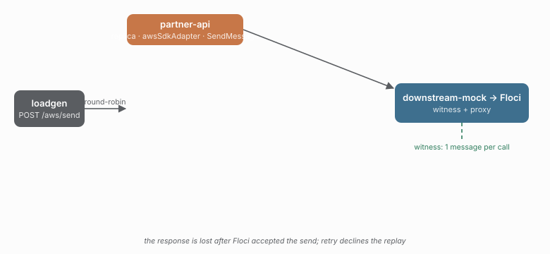

# 17 · Retry refuses to replay an accepted SQS send

**Claim:** when AWS accepts a `SendMessage` and the response is lost, Caracal's
retry does not send it again. The adapter declares `SendMessage` as
`replay: "unsafe"`, so the classification (`retryable`) is not enough to repeat
the call.

## The setup

```
loadgen → partner-api (awsSdkAdapter) → downstream-mock (witness/proxy) → Floci
                                              │
                                              └─ /_witness: queue depth from Floci
```

- `partner-api` uses `@gkoos/caracal/aws-sdk` with a real `SQSClient`
  (`maxAttempts: 1`, `useQueueUrlAsEndpoint: false`) pointed at the witness.
- The witness forwards `SendMessage` to Floci. For the first send it drains the
  successful response and returns a protocol-shaped `500`, simulating a response
  lost **after** the queue accepted the message.
- The queue's own `ApproximateNumberOfMessages` is the second witness. The proxy
  counts requests; Floci counts messages.

## Run

```sh
npm run aws:up       # core stack + Floci on :4566
npm run demo 17
npm run aws:down
```



No AWS account is involved. Floci accepts any non-empty credentials; the demo
uses `test`/`test`.

## Why it fails without per-command capabilities

A blanket `replay: "safe"` would retry the lost send and put a second message in
the queue. A blanket `"unsafe"` would also refuse to retry reads. The adapter's
per-command decision is what makes this check meaningful:

- `aws.send` is `SendMessage`, so `replay` is `"unsafe"`.
- The first 500 is classified `retryable` (an injected `InternalServerException`).
- `retry` declines with `reason: "replay-unsafe"`.
- The queue holds one message for the call, not two.

## What this does and does not prove

It proves the adapter's replay declaration reaches the real SDK and the real
wire path: the proxy sees one attempt, and Floci's queue sees one message. The
lost response is injected by the witness, not produced by AWS; a Floci-backed
study cannot claim real AWS failure distributions. The queue depth is the
independent number the check is decided on.
