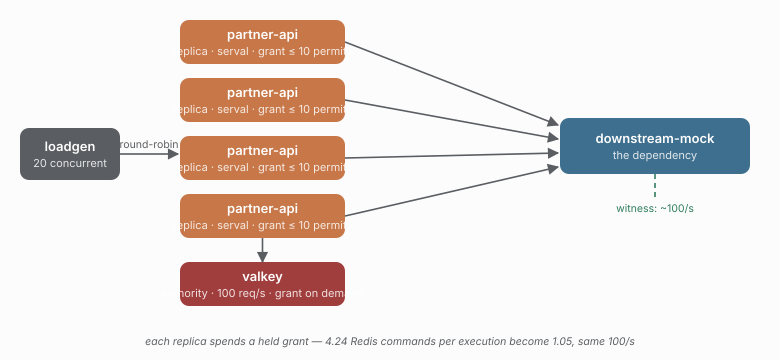

# 25 — One shared rate budget, held locally

> **Question:** What does a shared rate budget cost when each replica spends a grant it already holds?

The same workload, the same four replicas and the same shared rate budget as
[12-rate-distributed](../12-rate-distributed/README.md), with the coordination
boundary moved once more: instead of asking the authority for permission on every
call, each replica asks for a *chunk* of the budget — a grant of up to
`RATE_LIMIT_BURST` permits, valid for `SERVAL_VALIDITY_MS` — and spends it locally.

```sh
npm run demo 25
npm run compare 12 25
```



## What the comparison shows

| KPI | 12 strict | 25 delegated |
|---|---|---|
| dependency rate | 101/s | 101/s |
| dependency peak in flight | 8 | 8 |
| admitted by the rate limiter | 1511 | 1510 |
| shed as `rate-exceeded` | 4907 | 4733 |
| coordinator trips per execution | 4.24 | **1.05** |
| p99 latency | 57ms | 52ms |
| breaker opens | 0 | 0 |
| lease lost | 0 | 0 |

The safety claim is unchanged: the dependency sustained the budget it was given
(100 req/s, never the ~400 offered), the surplus was shed as `rate-exceeded` at
the client, and nothing opened a breaker. What moved is the price — **4.24 Redis
commands per execution became 1.05**.

## The deviation, stated

The saving is on the admitted path, not the shed one. A replica that runs out of
grant must ask the authority for more, because only the authority knows the
fleet-wide budget — so a *refused* call still costs a round trip, and 1.05 is
dominated by the 4733 refusals asking for capacity that was already spent. A grant
is also capacity stranded inside one process: it is sized to the burst here, which
is why the achieved rate matches the strict row instead of falling short of it.
A larger grant would buy fewer round trips and more stranding, which is the
trade-off `grantSize` documents.

## What this study does not show

What the fleet does when the authority cannot answer. A held grant keeps admitting
until its horizon lapses and then stops dead — there is no equivalent of the
bulkhead's per-process ceiling to bound the outage, because the budget only exists
in Redis. That is the rate-axis twin of studies
[20](../20-serval-redis-outage/README.md) and
[21](../21-serval-redis-outage-bounded/README.md), and it is not measured here.

## Compare with

```sh
npm run compare 12 25    # strict against delegated, same workload
npm run compare 02 18    # the same comparison on the concurrency axis
npm run demo 13          # rate is not a concurrency ceiling
```
