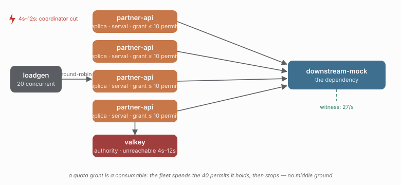

# 26 — Delegated rate limiter, with the coordinator gone

> **Question:** What is left of a shared rate budget when the authority cannot answer?

The same delegated rate limiter as [25](../25-serval-rate-delegated/README.md), with
the coordinator cut for eight seconds — the rate-axis twin of
[20](../20-serval-redis-outage/README.md), where the bulkhead faces the same outage.

```sh
npm run demo 26
npm run compare 20 26
```



## What it shows

| KPI | 26 delegated rate | 20 delegated bulkhead |
|---|---|---|
| dependency rate | **27/s** (budget 100) | — |
| admitted during the run | 407 | 889 |
| refusals | 1140 rate-limited, 2013 coordinator-unavailable | — |
| `ratelimit.degraded` | 1874 | — |
| coordinator trips per execution | 1.49 | 0.9 |
| breaker opens | 0 | 0 |

The ceiling held: the dependency never saw more than its budget, because the only
permits available while the authority is gone are the grants already held, and they
are part of the same budget. The fleet did not overshoot — it **collapsed**, to the
40 permits it was holding (4 replicas × a grant of 10), and stayed there for the
rest of the outage.

## The asymmetry this study exists to show

The bulkhead has a middle ground: a replica keeps serving from its allocation and
stops when it lapses (20). The rate limiter has none, and the reason is in the
coordinator's own contract — *an unreachable authority never invents a permit, it
reports that it could not decide*. A quota grant is a consumable, not re-derivable
state: no read can reconstruct what a replica holds, so there is nothing to
reconcile and nothing to fall back on. The outage therefore resolves to a refusal,
and the fleet's throughput is whatever stock it happened to be holding.

The cost is visible too: **1.49 round trips per execution against 0.9 for the
bulkhead**, because a failed issuance leaves no local hint to short-circuit on. Every
call during the outage asks the authority again, and cannot be answered.

## What this study does not show

A bounded offline mode for the rate axis. The bulkhead's answer is a per-process
ceiling (`bulkhead.local`, studies
[19](../19-serval-with-local-ceiling/README.md) and
[21](../21-serval-redis-outage-bounded/README.md)) which needs no authority at all;
there is no equivalent composition for a rate limit here, so the only lever is how
much stock each replica happens to hold when the authority goes away.

## Compare with

```sh
npm run compare 20 26    # the bulkhead's middle ground, on the rate axis
npm run compare 12 25    # the same rate budget, coordinator healthy
```
