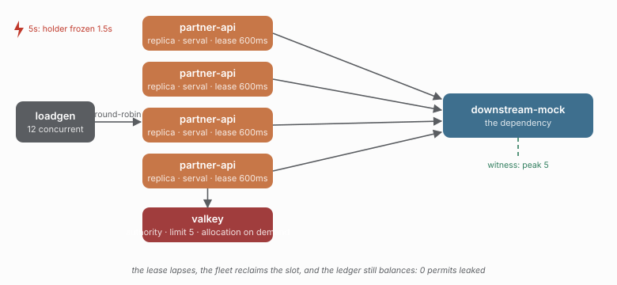

# 27 — The permit ledger, with a holder frozen past its lease

> **Question:** When a delegated holder stops renewing, does its capacity come back?

The same delegated bulkhead as [18](../18-serval-delegated/README.md), with one
replica frozen for 1.5 seconds — longer than its 600ms lease, so it cannot renew
what it holds and the fleet has to reclaim the slot without it.

```sh
npm run demo 27
npm run compare 18 27
```



## What it shows

| KPI | 27 |
|---|---|
| permits that outlived the run | **0** |
| `bulkhead.lease-lost` events | 1 |
| refusals | 364 capacity, 1 lease-lost |
| dependency peak in flight | 5 (the shared limit) |
| coordinator trips per execution | 0.82 |
| requests | 563 |

The safety claim is unchanged — the dependency never saw more than the fleet's
shared limit, even while a holder was frozen — and the accounting closes: every
permit the fleet admitted came back.

## What the ledger means here

`permitsLeaked = admitted − released`, measured by the demo because only the demo
knows which replicas were asked to stop. `bulkhead.lease-lost` is deliberately *not*
subtracted: a holder that loses its lease still releases the permit when its work
ends, so subtracting it would count the same permit twice. Study
[07](../07-chaos/README.md) records both counters at 126 in a run that kills one
replica and freezes another.

## What this study does not show

A killed holder's ledger, and it cannot: a SIGKILLed replica stops writing events, so
no ledger it leaves behind can balance. That case is measured from the other side by
07, which samples Redis's own live lease count — the authoritative instrument, and
one caracal does not control. What this study adds is the client's own accounting,
which is the only place a *soft* leak would show: a permit admitted and then neither
released nor renewed while the process is still alive.

## Compare with

```sh
npm run compare 18 27    # the same fleet, with a holder frozen mid-permit
npm run demo 07          # the killed-replica case, from Redis's own lease count
```
