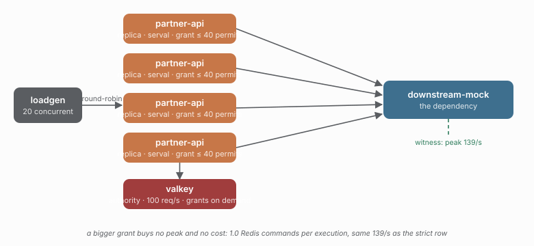

# 28 — A larger grant, held locally

> **Question:** What does a bigger chunk of the budget buy, and what does it cost in peak rate?

Study [25](../25-serval-rate-delegated/README.md)'s delegated rate limiter with a grant
four times larger — 40 permits instead of 10 — against
[29](../29-strict-rate-burst/README.md), which has the same burst and arbitrates
every admission. Both run with dependency headroom (`capacity: 64`), because a
40-permit burst against the 8-slot capacity of 12/25 measures the dependency's
overload (study [08](../08-overload/README.md)), not the burst knob.

```sh
npm run demo 28
npm run compare 28 29
```



## What the comparison shows

| KPI | 28 delegated (grant 40) | 29 strict (burst 40) | 25 delegated (grant 10) |
|---|---|---|---|
| dependency peak 1s rate | 139/s | 140/s | 110/s |
| dependency sustained rate | 103/s | 103/s | 101/s |
| admitted | 1541 | 1542 | 1511 |
| coordinator trips per execution | **1.0** | 4.24 | 1.05 |
| breaker opens | 0 | 0 | 0 |

## What the numbers say

The burst is *configured*, not amplified. Both topologies peak at the same ~140/s,
because the burst knob is what allows it and the offered load is steady: a grant
held locally is drawn on demand, so four grants of 40 do not become a 160/s spike.
The delegated fleet's peak is the load's, not its stock's.

The grant size buys nothing further. 25 (grant 10) and 28 (grant 40) cost the same
**1.05 → 1.0** round trips per execution, and the reason is in 25's README: the cost
is dominated by *refusals*, which cannot be served from stock — a refused call must
ask the authority for capacity that is already spent, whatever the grant size. What
a larger grant does buy is fewer issuance requests on the admitted path, which is
already a small share of the total.

So the honest summary of the trade-off is narrower than the option's documentation
suggests: under steady load, a bigger grant neither raises the fleet's peak nor
lowers its cost. It only strands more capacity in processes that may not need it —
which this study cannot show, because stranding is invisible until the load moves.

## What this study does not show

Bursty arrival. That is the load shape where a held grant would be spent faster than
the authority could arbitrate, and where the delegated peak could exceed the strict
one. The demo's load generator offers a steady 400 req/s, so that case is unmeasured.

## Compare with

```sh
npm run compare 28 29    # the same burst, held locally vs arbitrated
npm run compare 12 25    # the same comparison at the default burst of 10
```
