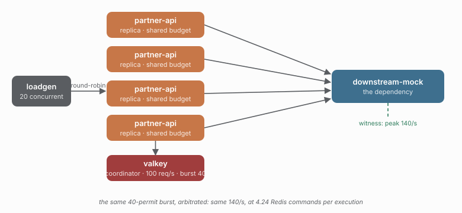

# 29 — The same burst, arbitrated

> **Question:** What does the same burst cost when every admission is arbitrated?

The strict control for [28](../28-serval-rate-burst/README.md): the same shared
100 req/s budget, the same 40-permit burst, and the same dependency headroom — with
every admission consulting the coordinator.

```sh
npm run demo 29
npm run compare 28 29
```



## What it shows

| KPI | 29 strict | 28 delegated |
|---|---|---|
| dependency peak 1s rate | 140/s | 139/s |
| dependency sustained rate | 103/s | 103/s |
| admitted | 1542 | 1541 |
| coordinator trips per execution | **4.24** | 1.0 |
| breaker opens | 0 | 0 |

The two topologies are indistinguishable on the dependency's own counters: the same
sustained rate, the same peak, the same admitted count. The whole difference is the
price — **4.24 Redis commands per execution against 1.0** — which is the claim study
18 makes on the concurrency axis, restated here for the rate axis at a larger burst.

Without the headroom (`capacity: 64`) this study fails in an instructive way: a
40-permit burst arrives as a single spike of 40 concurrent calls, the capacity-8
dependency sheds them, and the fleet's own breaker opens on the resulting failures.
That is study [08](../08-overload/README.md)'s finding reached through the burst knob,
and it is why both members of this pair raise the capacity.

## Compare with

```sh
npm run compare 28 29    # the same burst, held locally vs arbitrated
npm run compare 12 29    # the same topology at the default burst of 10
```
